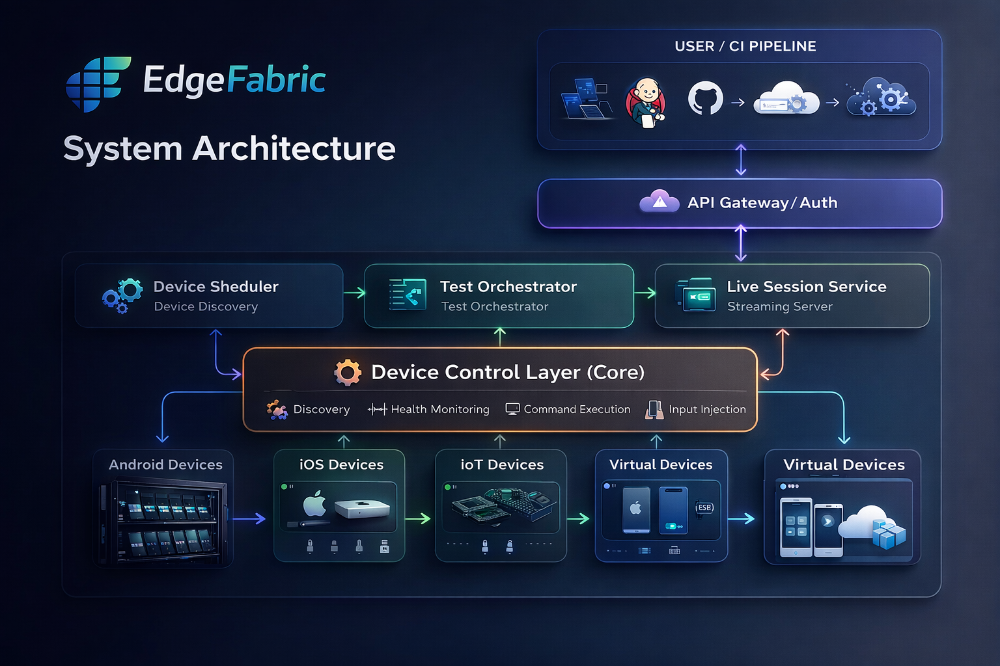
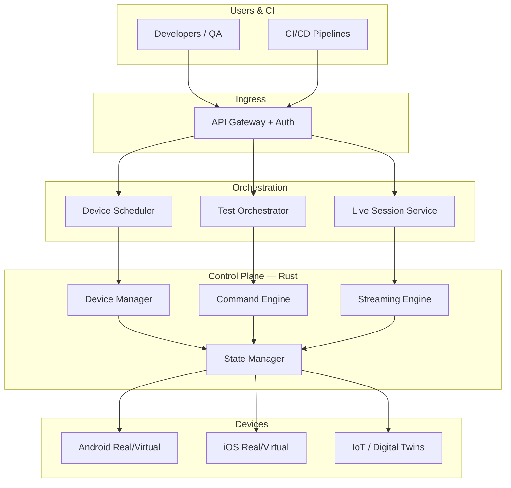
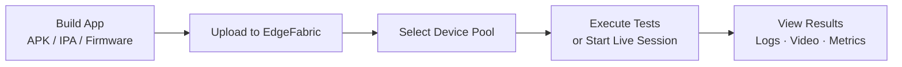

<p align="center">
  
</p>

<h3 align="center">Unified device cloud to test, automate, and scale across real and virtual devices.</h3>

<p align="center">
  <a href="docs/SYSTEM_DESIGN.md">System Design</a> ·
  <a href="docs/ARCHITECTURE.md">Architecture & Diagrams</a> ·
  <a href="docs/API_REFERENCE.md">API Reference</a>
</p>

---

## Overview

EdgeFabric is a next-generation device cloud platform that enables developers and QA teams to run tests, debug applications, and automate workflows across:

- **Real mobile devices** — Android & iOS
- **Virtual devices** — Emulators & simulators
- **IoT devices** — Hardware boards & digital twins

Built in **Rust** for performance, safety, and low-level device control.

---

## Architecture at a Glance

<p align="center">
  
</p>



> See [Architecture & Diagrams](docs/ARCHITECTURE.md) for full schematics including network topology and deployment layout.

---

## Key Features

| Feature | Description |
|---------|-------------|
| **Unified Device Abstraction** | Single API across Android, iOS, IoT — real and virtual |
| **Hybrid Device Cloud** | Real devices for accuracy, virtual for scale, intelligent routing |
| **Real-Time Streaming** | < 200 ms latency WebRTC streaming with remote control |
| **CI/CD Native** | First-class GitHub Actions, Jenkins, GitLab CI integration |
| **Parallel Testing** | Distribute test suites across device pools automatically |
| **IoT Support** | Firmware flashing, serial/SSH access, sensor simulation |
| **Secure Multi-Tenancy** | Per-session isolation, device wipe, RBAC, TLS everywhere |

---

## Tech Stack

| Layer | Technology |
|-------|-----------|
| Core platform | **Rust** (Axum, tonic, tokio) |
| API | REST + gRPC (Protocol Buffers) |
| Streaming | WebRTC (webrtc-rs) |
| Android control | ADB, scrcpy |
| iOS control | WebDriverAgent, Xcode tools |
| IoT | MQTT (rumqttc), SSH, Serial |
| State store | PostgreSQL + Redis |
| Messaging | NATS |
| Virtual devices | QEMU/KVM, Kubernetes |

---

## Workflow



---

## Core Concepts

| Concept | Description |
|---------|-------------|
| **Device Pool** | Group of real/virtual devices matching a filter |
| **Session** | Active, isolated interaction with a single device |
| **Scheduler** | Allocates devices by availability, type, priority |
| **Control Plane** | Central orchestration — the Rust core |
| **Edge Node** | Physical rack hosting real devices + local agent |

---

## Network Architecture

<p align="center">
  
</p>

> Multi-region edge deployment with secure VPN tunnels, global load balancing, and CDN/WAF at the perimeter. See [Architecture & Diagrams](docs/ARCHITECTURE.md#network-architecture) for details.

---

## Project Structure

```
EdgeFabric/
├── Cargo.toml                  # Workspace root
├── README.md
├── docs/
│   ├── SYSTEM_DESIGN.md        # Detailed system design
│   ├── ARCHITECTURE.md         # Diagrams & schematics
│   ├── API_REFERENCE.md        # REST & gRPC API spec
│   └── assets/                 # Images, diagrams, PPTX
│       ├── EdgeFabric_Logo.png
│       ├── EdgeFabric_SystemArchitecture.png
│       └── EdgeFabric_NetworkArchitecture.png
├── crates/
│   ├── ef-core/                # Shared types, traits, errors
│   ├── ef-api/                 # REST + gRPC API server
│   ├── ef-scheduler/           # Device allocation engine
│   ├── ef-orchestrator/        # Test job orchestration
│   ├── ef-control/             # Device control plane
│   ├── ef-streaming/           # WebRTC streaming engine
│   ├── ef-agent/               # Edge node agent binary
│   └── ef-cli/                 # Developer CLI tool
├── proto/                      # Protocol Buffer definitions
├── config/                     # Environment configs
└── tests/                      # Integration tests
```

---

## Security

| Control | Implementation |
|---------|---------------|
| Transport | TLS 1.3 (API), DTLS + SRTP (WebRTC) |
| Authentication | OAuth 2.0 / JWT / API keys |
| Session isolation | VLAN segmentation, container namespaces |
| Device sanitization | Full wipe + snapshot restore per session |
| Access control | RBAC with tenant-scoped permissions |
| Audit | Immutable operation log |

---

## Roadmap

- [ ] Smart AI-powered device scheduling
- [ ] GPU-accelerated streaming
- [ ] Advanced network simulation (latency, packet loss)
- [ ] Visual regression testing
- [ ] Distributed edge clusters with autonomous failover
- [ ] Plugin system for custom device protocols

---

## Documentation

| Document | Description |
|----------|-------------|
| [System Design](docs/SYSTEM_DESIGN.md) | Detailed design: layers, modules, data flow, security |
| [Architecture & Diagrams](docs/ARCHITECTURE.md) | All schematics: system, network, deployment, sequences |
| [API Reference](docs/API_REFERENCE.md) | REST endpoints, gRPC services, error codes |

---

## Contributing

Contributions are welcome! Feel free to open issues or submit pull requests.

---

## License

MIT License

---

<p align="center">
  
  <br/>
  <i>The control plane for global device infrastructure.</i>
</p>
