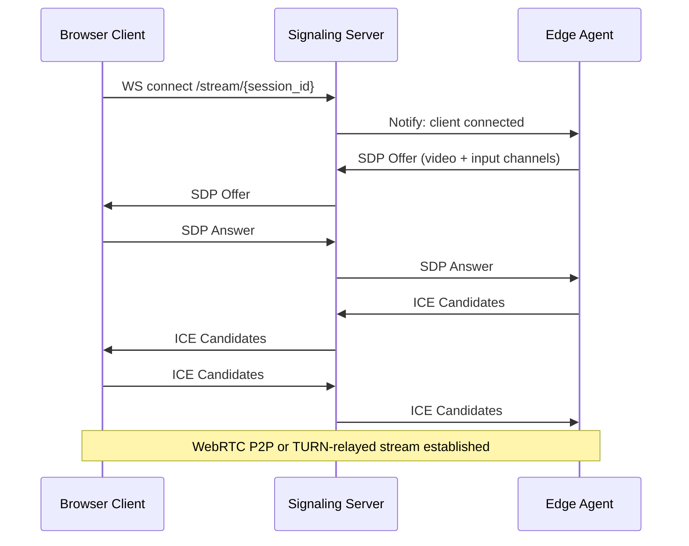

<p align="center">
  
</p>

<h1 align="center">API Reference</h1>

<p align="center">
  REST &amp; gRPC API specification for the EdgeFabric device cloud platform.
</p>

---

## Table of Contents

- [Authentication](#authentication)
- [Devices API](#devices-api)
- [Sessions API](#sessions-api)
- [Tests API](#tests-api)
- [Streaming API](#streaming-api)
- [Logs & Artifacts API](#logs--artifacts-api)
- [gRPC Services](#grpc-services)
- [Error Codes](#error-codes)
- [Rate Limiting](#rate-limiting)

---

## Authentication

All API requests require authentication via **Bearer token** (JWT) or **API key**.

```
Authorization: Bearer <jwt_token>
```

or

```
X-API-Key: <api_key>
```

### Token Exchange

```http
POST /auth/token
Content-Type: application/json

{
  "client_id": "your-client-id",
  "client_secret": "your-client-secret",
  "grant_type": "client_credentials"
}
```

**Response:**
```json
{
  "access_token": "eyJ...",
  "token_type": "Bearer",
  "expires_in": 3600
}
```

---

## Devices API

### List Devices

```http
GET /api/v1/devices?os=android&status=available&version=14
```

**Query Parameters:**

| Parameter | Type | Description |
|-----------|------|-------------|
| `os` | string | Filter by OS: `android`, `ios`, `iot` |
| `status` | string | `available`, `busy`, `offline` |
| `version` | string | OS version filter |
| `type` | string | `real`, `virtual` |
| `region` | string | Geographic region |

**Response:**
```json
{
  "devices": [
    {
      "id": "dev-a1b2c3",
      "name": "Pixel 7 Pro",
      "os": "android",
      "version": "14",
      "type": "real",
      "status": "available",
      "region": "us-west",
      "capabilities": ["gpu", "nfc", "5g"]
    }
  ],
  "total": 42,
  "page": 1
}
```

### Get Device Details

```http
GET /api/v1/devices/{device_id}
```

### Get Device Health

```http
GET /api/v1/devices/{device_id}/health
```

**Response:**
```json
{
  "device_id": "dev-a1b2c3",
  "status": "healthy",
  "cpu_usage": 12.5,
  "memory_usage": 45.2,
  "battery_level": 87,
  "temperature": 32.1,
  "uptime_seconds": 86400,
  "last_heartbeat": "2026-04-06T10:30:00Z"
}
```

---

## Sessions API

### Create Session

```http
POST /api/v1/sessions
Content-Type: application/json

{
  "device_filter": {
    "os": "android",
    "version": ">=13",
    "type": "real"
  },
  "timeout_minutes": 30,
  "purpose": "manual_testing"
}
```

**Response:**
```json
{
  "session_id": "sess-x1y2z3",
  "device_id": "dev-a1b2c3",
  "status": "active",
  "stream_url": "wss://stream.edgefabric.io/sess-x1y2z3",
  "expires_at": "2026-04-06T11:00:00Z"
}
```

### Get Session

```http
GET /api/v1/sessions/{session_id}
```

### End Session

```http
DELETE /api/v1/sessions/{session_id}
```

### List Active Sessions

```http
GET /api/v1/sessions?status=active
```

---

## Tests API

### Submit Test Job

```http
POST /api/v1/tests/run
Content-Type: multipart/form-data

app: <binary>                        # APK / IPA / firmware
test_suite: <binary>                 # Test package
device_filter: {"os": "android", "version": ">=13"}
parallelism: 4
timeout_minutes: 60
```

**Response:**
```json
{
  "job_id": "job-m1n2o3",
  "status": "queued",
  "devices_allocated": 4,
  "estimated_duration_minutes": 15
}
```

### Get Job Status

```http
GET /api/v1/tests/{job_id}
```

**Response:**
```json
{
  "job_id": "job-m1n2o3",
  "status": "running",
  "progress": {
    "total_tests": 120,
    "passed": 85,
    "failed": 3,
    "running": 12,
    "pending": 20
  },
  "devices": [
    {"device_id": "dev-a1b2c3", "tests_complete": 30, "status": "running"}
  ]
}
```

### Get Test Results

```http
GET /api/v1/tests/{job_id}/results
```

### Cancel Job

```http
POST /api/v1/tests/{job_id}/cancel
```

---

## Streaming API

### WebRTC Signaling

Session streaming uses WebRTC. The signaling flow:



### Input Channel

Once the WebRTC data channel is open, send input events as JSON:

```json
{"type": "tap", "x": 540, "y": 960}
{"type": "swipe", "x1": 540, "y1": 1200, "x2": 540, "y2": 400, "duration_ms": 300}
{"type": "key", "keycode": 4}
{"type": "text", "value": "hello world"}
```

---

## Logs & Artifacts API

### Get Session Logs

```http
GET /api/v1/logs/{session_id}?level=error&since=2026-04-06T10:00:00Z
```

### Download Video Recording

```http
GET /api/v1/artifacts/{session_id}/video
```

### Download Screenshots

```http
GET /api/v1/artifacts/{session_id}/screenshots
```

### Download Test Report

```http
GET /api/v1/artifacts/{job_id}/report?format=junit
```

---

## gRPC Services

Internal services communicate via gRPC (Protocol Buffers). Key service definitions:

```protobuf
service DeviceService {
  rpc ListDevices (ListDevicesRequest) returns (ListDevicesResponse);
  rpc GetDevice (GetDeviceRequest) returns (Device);
  rpc AllocateDevice (AllocateRequest) returns (AllocateResponse);
  rpc ReleaseDevice (ReleaseRequest) returns (ReleaseResponse);
  rpc StreamHealth (Empty) returns (stream HealthEvent);
}

service TestService {
  rpc RunTest (RunTestRequest) returns (RunTestResponse);
  rpc GetJobStatus (JobStatusRequest) returns (JobStatus);
  rpc CancelJob (CancelJobRequest) returns (CancelJobResponse);
  rpc StreamResults (JobStatusRequest) returns (stream TestResult);
}

service SessionService {
  rpc CreateSession (CreateSessionRequest) returns (Session);
  rpc EndSession (EndSessionRequest) returns (EndSessionResponse);
  rpc SendCommand (CommandRequest) returns (CommandResponse);
  rpc StreamLogs (SessionRequest) returns (stream LogEntry);
}
```

---

## Virtual IoT & VeerOS Backends

### Backend Registry

**List backends**
```
GET /api/v1/devices/virtual-iot/backends
```

**Create backend** (provisions a VeerOS VM via the local agent or a remote agent)
```
POST /api/v1/devices/virtual-iot/backends
```
```json
{
  "controller_type": "esp32c6",
  "region": "local",
  "provider": "veeros-vm",
  "vm_name": "my-esp32"
}
```

**Attach / detach backend**
```
POST /api/v1/devices/{id}/virtual-iot/backend/attach
POST /api/v1/devices/{id}/virtual-iot/backend/detach
```

**Inject sensor value**
```
POST /api/v1/devices/{id}/virtual-iot/sensors
```
```json
{ "sensor": "temperature", "value": "27.5" }
```

**Shell access (REST info)**
```
GET /api/v1/devices/{id}/virtual-iot/shell
```

**Shell WebSocket bridge**
```
GET /api/v1/devices/{id}/virtual-iot/shell/ws
```

---

## Agent Streaming Server API (port 7070)

Each EdgeFabric agent exposes a local HTTP/WS API directly on port 7070.
This server starts immediately on agent launch, **independent of control-plane connectivity**.

### VM Lifecycle

| Method | Path | Description |
|--------|------|-------------|
| `GET`    | `/health` | Health check |
| `GET`    | `/veeros/vms` | List all VMs as JSON |
| `POST`   | `/veeros/vms` | Create VM |
| `GET`    | `/veeros/vms/{name}` | VM status |
| `POST`   | `/veeros/vms/{name}/start` | Start VM |
| `POST`   | `/veeros/vms/{name}/stop` | Stop VM |
| `POST`   | `/veeros/vms/{name}/restart` | Restart VM |
| `GET`    | `/veeros/vms/{name}/config` | VM config map |
| `GET`    | `/veeros/vms/{name}/shell_info` | Shell host/port/connect command |
| `POST`   | `/veeros/vms/{name}/sensor` | Inject sensor value |
| `DELETE` | `/veeros/vms/{name}` | Destroy VM |
| `GET`    | `/ws/veeros/{name}/shell` | WebSocket shell session |

**Create VM request body:**
```json
{
  "vm_name": "my-esp32",
  "hostname": "my-esp32",
  "target": "esp32c6",
  "net_mode": "nat",
  "memory_mb": 128
}
```

`net_mode` values for `esp32c6` target:

| `net_mode` | Runtime | Platforms | Notes |
|---|---|---|---|
| `nat` | `qemu-system-riscv32` | Linux, macOS | Default; requires QEMU |
| `user` | `veer-vm` binary | macOS (HVF), Linux (KVM) | Rootless, no QEMU needed; build `veer-vm` first |
| `bridge` | QEMU TAP | Linux only | Requires root; VMs visible on LAN |

**List VMs response:**
```json
[
  {
    "name": "my-esp32",
    "target": "esp32c6",
    "hostname": "my-esp32",
    "memory": 128,
    "ssh_port": 2230,
    "net_mode": "nat",
    "status": "running",
    "created": "2026-05-03T10:00:00+05:30",
    "last_started": "2026-05-03T10:01:00+05:30"
  }
]
```

---

## Error Codes

| HTTP Status | Code | Description |
|-------------|------|-------------|
| 400 | `INVALID_REQUEST` | Malformed request body or parameters |
| 401 | `UNAUTHORIZED` | Missing or invalid authentication |
| 403 | `FORBIDDEN` | Insufficient permissions |
| 404 | `NOT_FOUND` | Resource does not exist |
| 409 | `CONFLICT` | Device already allocated / session active |
| 429 | `RATE_LIMITED` | Too many requests |
| 503 | `SERVICE_UNAVAILABLE` | No devices available matching criteria |
| 504 | `TIMEOUT` | Operation timed out |

**Error Response Format:**
```json
{
  "error": {
    "code": "SERVICE_UNAVAILABLE",
    "message": "No Android 14 devices available in us-west region",
    "request_id": "req-abc123"
  }
}
```

---

## Rate Limiting

| Tier | Requests/min | Concurrent Sessions |
|------|-------------|-------------------|
| Free | 60 | 2 |
| Pro | 600 | 20 |
| Enterprise | 6000 | Unlimited |

Rate limit headers are included in every response:

```
X-RateLimit-Limit: 600
X-RateLimit-Remaining: 587
X-RateLimit-Reset: 1712400000
```

---

<p align="center"><i>Back to <a href="../README.md">README</a> · <a href="SYSTEM_DESIGN.md">System Design</a> · <a href="ARCHITECTURE.md">Architecture & Diagrams</a></i></p>
