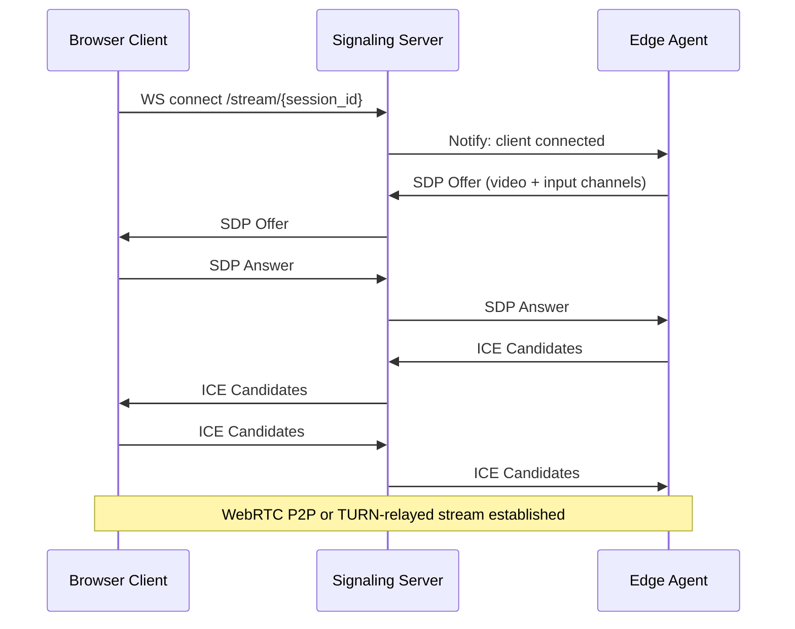

<p align="center">
  
</p>

<h1 align="center">API Reference</h1>

<p align="center">
  REST &amp; gRPC API specification for the EdgeFabric device cloud platform.
</p>

---

## Table of Contents

- [Authentication](#authentication)
- [Resources / host installers](#resources--host-installers)
- [Devices API](#devices-api)
- [Runners API](#runners-api)
- [Builds API](#builds-api)
- [Sessions API](#sessions-api)
- [Tests API](#tests-api)
- [Streaming API](#streaming-api)
- [Logs & Artifacts API](#logs--artifacts-api)
- [gRPC Services](#grpc-services)
- [Error Codes](#error-codes)
- [Rate Limiting](#rate-limiting)
- [VS Code Developer Flow](VSCODE_DEVELOPER_FLOW.md)

---

## Authentication

All API requests require authentication via **Bearer token** (JWT) or **API key**.

```
Authorization: Bearer <jwt_token>
```

or

```
X-API-Key: <api_key>
```

### Token Exchange

```http
POST /api/v1/auth/login
Content-Type: application/json

{
  "api_key": "your-api-key"
}
```

**Response:**
```json
{
  "token": "eyJ...",
  "tenant_id": "a0000000-0000-0000-0000-000000000001",
  "expires_in": 3600
}
```

Local development commonly uses `efdev-key-00000000` as the API key.

---

## Resources / host installers

Public catalog of worker packages (no auth). Used by the dashboard **Downloads** page.

```http
GET /api/v1/resources
```

```http
GET /api/v1/resources/files/edgefabric-host-aarch64-apple-darwin.tar.gz
```

Files are served from `EF_RESOURCES_DIR`, `/var/www/edgefabric-dashboard/downloads`, or `dist/host`. Publish a package with `scripts/package-host.sh`.

---

## Discovery API

### List Discovered VeerOS Hosts

```http
GET /api/v1/discovery/hosts
Authorization: Bearer <jwt_token>
```

Optional quantum-only filter:

```http
GET /api/v1/discovery/hosts?quantum=true
Authorization: Bearer <jwt_token>
```

**Response:**
```json
{
  "hosts": [
    {
      "id": "...",
      "agent_id": "...",
      "host_id": "...",
      "hostname": "my-node.local",
      "ip_address": "192.168.29.5",
      "port": 2323,
      "capabilities": ["shell", "fold"],
      "quantum_capable": false,
      "verified": true,
      "last_seen_at": "2026-05-04T12:20:25Z"
    }
  ],
  "count": 1
}
```

---

## Devices API

### List Devices

```http
GET /api/v1/devices?os=android&status=available&version=14
```

**Query Parameters:**

| Parameter | Type | Description |
|-----------|------|-------------|
| `os` | string | Filter by OS: `android`, `ios`, `iot` |
| `status` | string | `available`, `busy`, `offline` |
| `version` | string | OS version filter |
| `type` | string | `real`, `virtual` |
| `region` | string | Geographic region |

**Response:**
```json
{
  "devices": [
    {
      "id": "dev-a1b2c3",
      "name": "Pixel 7 Pro",
      "os": "android",
      "version": "14",
      "type": "real",
      "status": "available",
      "region": "us-west",
      "capabilities": ["gpu", "nfc", "5g"]
    }
  ],
  "total": 42,
  "page": 1
}
```

### Get Device Details

```http
GET /api/v1/devices/{device_id}
```

### Get Device Health

```http
GET /api/v1/devices/{device_id}/health
```

**Response:**
```json
{
  "device_id": "dev-a1b2c3",
  "status": "healthy",
  "cpu_usage": 12.5,
  "memory_usage": 45.2,
  "battery_level": 87,
  "temperature": 32.1,
  "uptime_seconds": 86400,
  "last_heartbeat": "2026-04-06T10:30:00Z"
}
```

---

## Runners API

Runner APIs provide tenant-scoped registration of generic SSH hosts (macOS, Linux, Windows). Workloads match on capabilities, not runner class.

### Register Runner

```http
POST /api/v1/runners/register
Authorization: Bearer <jwt_token>
Content-Type: application/json

{
  "name": "lab-host-01",
  "device_id": "f2b6f0d6-9fa9-4d86-b14c-77ff9f4d3b66",
  "runner_class": "generic",
  "host_os": "linux",
  "architecture": "x86_64",
  "region": "in-lab",
  "labels": ["gpu", "team-a"],
  "capabilities": ["ssh", "cicd_runner", "linux_runner"],
  "max_concurrency": 2
}
```

`host_os` is `macos`, `linux`, or `windows`. `runner_class` other than `generic` (`mlx-cluster`, `ios`, `linux`, `windows`) is normalized to `generic`.

`device_id` should point to an already discovered/registered host from ef-agent and dashboard inventory.
When `host` is omitted and `device_id` is provided, EdgeFabric derives `host:port` from device metadata (`serial` or `ip_address`).

Manual override remains available:

```json
{
  "name": "mac-mini-runner-01",
  "device_id": "f2b6f0d6-9fa9-4d86-b14c-77ff9f4d3b66",
  "host": "192.168.29.44",
  "port": 22,
  "runner_class": "ios-build"
}
```

### List Runners

```http
GET /api/v1/runners
Authorization: Bearer <jwt_token>
```

### Get Runner

```http
GET /api/v1/runners/{runner_id}
Authorization: Bearer <jwt_token>
```

### Drain / Resume Runner

Drain:

```http
POST /api/v1/runners/{runner_id}/drain
Authorization: Bearer <jwt_token>
Content-Type: application/json

{ "drained": true }
```

Resume:

```http
POST /api/v1/runners/{runner_id}/drain
Authorization: Bearer <jwt_token>
Content-Type: application/json

{ "drained": false }
```

### Probe Runner Reachability

```http
POST /api/v1/runners/{runner_id}/probe
Authorization: Bearer <jwt_token>
Content-Type: application/json

{
  "ssh_user": "builder"
}
```

`ssh_user` is optional. If omitted, EdgeFabric tries a small fallback username set.

Current probe mode performs:

- TCP reachability to `host:port`
- SSH authentication probe (batch mode, key-based)
- Toolchain checks for runner capabilities:
  - Apple: `xcode`, `simctl`, `fastlane`, `codesign`, `cocoapods`, `swiftpm`
  - Linux: `linux_runner`, `linux_deploy`, `docker`, `cuda`, `iot_toolchain`, `esp32`, `rpi`, `iot_deploy`
  - Windows: `windows_runner`, `windows_deploy`, `msbuild`, `powershell`, `wsl`, `docker`, `cuda`
  - Quantum/VeerOS: `quantum_sdk`, `quantum_simulator`, `veeros_host`
  - ML: `mlx`, `ane`, `llm_infer`, `llm_train`, `pipeline_pp` (macOS MLX or Linux/Windows Ollama/CUDA)
  - Shared host roles: `macos_runner`, `macos_deploy`, `linux_runner`, `windows_runner`

Probe also records `hardware` (`chip`, `cpu_cores`, `gpu_cores`, `ane_cores`, `unified_memory_gb`, `link_mbps`, `mlx_version`, `os`) for SSH hosts.

Probe metadata and discovered capabilities are stored in runner health and returned in the response.

Register any SSH host as `"runner_class": "generic"` with `"host_os": "macos" | "linux" | "windows"`. `"mlx-cluster"` / `"linux"` / `"windows"` class names are stored as `generic`. The same host can be an ML node, CI runner, and app deploy target.

---

## ML Cluster API (M6 Mini fabric)

LAN pipeline-parallel inference and training. Activation traffic stays on 2.5 GbE; VeerSetu is for enrollment and publishing rank-0 only.

### List / heartbeat nodes

```http
GET /api/v1/ml/nodes
POST /api/v1/ml/nodes/heartbeat
Authorization: Bearer <jwt_token>
```

Heartbeat body:

```json
{
  "runner_id": "f2b6f0d6-9fa9-4d86-b14c-77ff9f4d3b66",
  "worker_host": "192.168.29.41",
  "worker_http_port": 8090,
  "worker_dataplane_port": 8091,
  "free_memory_gb": 18.5,
  "pipeline_rank": 0
}
```

Response includes `assignment` (`cluster`, `rank`, `members`, `job`) so `ef-ml-worker` can load the active job.

### Create cluster (leases N runners)

```http
POST /api/v1/ml/clusters
Authorization: Bearer <jwt_token>
Content-Type: application/json

{
  "name": "lab-minis",
  "role": "pipeline",
  "size": 3,
  "interconnect_cidrs": ["192.168.29.0/24"],
  "required_capabilities": ["mlx", "llm_infer", "pipeline_pp"]
}
```

`role` is `pipeline` | `replica` | `diloco`. Omit `size` and pass `runner_ids` to lease specific Minis.

```http
GET /api/v1/ml/clusters
GET /api/v1/ml/clusters/{cluster_id}
```

### Jobs

```http
POST /api/v1/ml/jobs
Authorization: Bearer <jwt_token>
Content-Type: application/json

{
  "cluster_id": "d2a81f42-95fb-4fb2-8e1f-85fe067feab4",
  "kind": "infer_serve",
  "model_id": "toy-pp",
  "quantization": "q4",
  "context_length": 2048,
  "n_layers": 12,
  "hidden_size": 256
}
```

`kind`: `infer_serve` | `train_lora` | `train_diloco` | `train_pipeline`.

```http
GET /api/v1/ml/jobs
GET /api/v1/ml/jobs/{job_id}
POST /api/v1/ml/jobs/{job_id}/metrics
POST /api/v1/ml/jobs/{job_id}/cancel
```

### OpenAI-compatible gateway (proxies rank-0 on LAN)

```http
POST /api/v1/ml/v1/chat/completions
Authorization: Bearer <jwt_token>
Content-Type: application/json

{
  "model": "toy-pp",
  "messages": [{"role": "user", "content": "hello"}],
  "max_tokens": 32,
  "cluster_id": "d2a81f42-95fb-4fb2-8e1f-85fe067feab4"
}
```

### Allocate Runner Lease

```http
POST /api/v1/runners/allocate
Authorization: Bearer <jwt_token>
Content-Type: application/json

{
  "region": "in-lab",
  "required_capabilities": ["cicd_runner", "xcode", "artifact_upload"],
  "required_labels": ["ios"],
  "lease_ttl_seconds": 1200,
  "build_job_id": "d2a81f42-95fb-4fb2-8e1f-85fe067feab4",
  "target_device_id": "f2b6f0d6-9fa9-4d86-b14c-77ff9f4d3b66"
}
```

Returns a matched runner and active lease. Concurrency is enforced against `max_concurrency`.

`target_device_id` is optional. When provided, it should reference a registered/discovered device visible in dashboard inventory.
Current allocation checks support iOS and can be extended for IoT/Virtual IoT orchestration policies.

### Release Runner Lease

```http
POST /api/v1/runners/leases/{lease_id}/release
Authorization: Bearer <jwt_token>
```

Marks an active lease as released so the runner can accept new allocations.

---

## Builds API

### List Builds

Returns tenant-scoped iOS build jobs ordered by newest first.

```http
GET /api/v1/builds
Authorization: Bearer <jwt_token>
```

Optional query parameters:

- `limit` (default `50`, max `200`)
- `offset` (default `0`)
- `status` (e.g. `queued`, `running`, `failed`, `succeeded`, `cancelled`)
- `device` (substring match on `device_id`)
- `source` (substring match on `source_ref`)

Response metadata includes `status_counts` (queued/provisioning/running/succeeded/failed/cancelled)
to support global status facets in dashboards while paging through results.

### Submit iOS Remote Build/Deploy

Runs `xcodebuild` on an allocated macOS runner over SSH and targets an already registered EdgeFabric iOS device by UDID.

```http
POST /api/v1/builds/ios
Authorization: Bearer <jwt_token>
Content-Type: application/json

{
  "source_ref": "project-main",
  "project_path": "/Users/builder/work/my-ios-app",
  "scheme": "MyApp",
  "configuration": "Debug",
  "target_device_id": "f2b6f0d6-9fa9-4d86-b14c-77ff9f4d3b66",
  "region": "in-lab",
  "required_runner_capabilities": ["xcode", "cicd_runner"],
  "required_runner_labels": ["ios"],
  "lease_ttl_seconds": 1800,
  "ssh_user": "builder"
}
```

Behavior:

- Allocates runner lease with capability and concurrency checks.
- Enqueues remote `xcodebuild -destination id=<target-udid> build` over SSH.
- Persists build status and logs.
- Releases lease on completion/failure/cancel.

Response code is `202 Accepted` when build is queued/running asynchronously.

### Submit IoT Build/Deploy (Linux SSH Runners)

Builds and deploys IoT workloads (initially focused on ESP32C6 and Raspberry Pi) via Linux SSH runners.

```http
POST /api/v1/builds/iot/deploy
Authorization: Bearer <jwt_token>
Content-Type: application/json

{
  "source_ref": "iot-main",
  "project_path": "/home/builder/work/edge-iot",
  "target_device_id": "0f730adf-2be2-4f5b-8ed7-36b471d8df0e",
  "board_profile": "esp32c6",
  "deploy_command": "pio run -t upload",
  "region": "edge-lab",
  "required_runner_capabilities": ["linux_runner", "iot_toolchain", "esp32"],
  "required_runner_labels": ["iot"],
  "lease_ttl_seconds": 1800,
  "ssh_user": "builder"
}
```

Behavior:

- Allocates Linux SSH runner with IoT capabilities.
- Executes remote build/deploy command (custom or board-profile default).
- Persists logs/status and releases lease on completion/failure/cancel.

### Submit Quantum Program Run (VeerOS Hosts)

Executes quantum programs through VeerOS-capable runners with either virtual processors/simulators or real hardware backends.

```http
POST /api/v1/builds/quantum/run
Authorization: Bearer <jwt_token>
Content-Type: application/json

{
  "source_ref": "quantum-main",
  "project_path": "/home/builder/work/qprog",
  "run_command": "python3 main.py",
  "backend_kind": "virtual",
  "backend_name": "veeros-vqp-1",
  "veeros_host_hint": "host-12",
  "region": "quantum-lab",
  "required_runner_capabilities": ["veeros_host", "quantum_sdk", "quantum_simulator"],
  "required_runner_labels": ["quantum"],
  "lease_ttl_seconds": 1800,
  "ssh_user": "builder"
}
```

Notes:

- `backend_kind` supports `virtual` or `real`.
- `virtual` requires `quantum_simulator`-class runners.
- `real` requires `quantum_hardware`-class runners.

### Get Build

```http
GET /api/v1/builds/{build_id}
Authorization: Bearer <jwt_token>
```

### Get Build Logs

```http
GET /api/v1/builds/{build_id}/logs
Authorization: Bearer <jwt_token>
```

While build is running, this endpoint attempts a live tail from the remote runner log.

### List Build Artifacts

```http
GET /api/v1/builds/{build_id}/artifacts
Authorization: Bearer <jwt_token>
```

### Cancel Build

```http
POST /api/v1/builds/{build_id}/cancel
Authorization: Bearer <jwt_token>
```

Cancel behavior:

- marks build as `cancelled`
- attempts remote process stop on runner
- releases active runner lease

---

## Sessions API

### Create Session

```http
POST /api/v1/sessions
Content-Type: application/json

{
  "device_filter": {
    "os": "android",
    "version": ">=13",
    "type": "real"
  },
  "timeout_minutes": 30,
  "purpose": "manual_testing"
}
```

**Response:**
```json
{
  "session_id": "sess-x1y2z3",
  "device_id": "dev-a1b2c3",
  "status": "active",
  "stream_url": "wss://stream.edgefabric.io/sess-x1y2z3",
  "expires_at": "2026-04-06T11:00:00Z"
}
```

### Get Session

```http
GET /api/v1/sessions/{session_id}
```

### End Session

```http
DELETE /api/v1/sessions/{session_id}
```

### List Active Sessions

```http
GET /api/v1/sessions?status=active
```

---

## Tests API

### Submit Test Job

```http
POST /api/v1/tests/run
Content-Type: multipart/form-data

app: <binary>                        # APK / IPA / firmware
test_suite: <binary>                 # Test package
device_filter: {"os": "android", "version": ">=13"}
parallelism: 4
timeout_minutes: 60
```

**Response:**
```json
{
  "job_id": "job-m1n2o3",
  "status": "queued",
  "devices_allocated": 4,
  "estimated_duration_minutes": 15
}
```

### Get Job Status

```http
GET /api/v1/tests/{job_id}
```

**Response:**
```json
{
  "job_id": "job-m1n2o3",
  "status": "running",
  "progress": {
    "total_tests": 120,
    "passed": 85,
    "failed": 3,
    "running": 12,
    "pending": 20
  },
  "devices": [
    {"device_id": "dev-a1b2c3", "tests_complete": 30, "status": "running"}
  ]
}
```

### Get Test Results

```http
GET /api/v1/tests/{job_id}/results
```

### Cancel Job

```http
POST /api/v1/tests/{job_id}/cancel
```

---

## Streaming API

### WebRTC Signaling

Session streaming uses WebRTC. The signaling flow:



### Input Channel

Once the WebRTC data channel is open, send input events as JSON:

```json
{"type": "tap", "x": 540, "y": 960}
{"type": "swipe", "x1": 540, "y1": 1200, "x2": 540, "y2": 400, "duration_ms": 300}
{"type": "key", "keycode": 4}
{"type": "text", "value": "hello world"}
```

### VeerOS Shell WebSocket

The VeerOS shell endpoint accepts raw terminal bytes over WebSocket.

```http
GET /api/v1/veeros/shell/ws?host=<host>&port=<port>&agent_id=<agent_id>
Authorization: Bearer <jwt_token>
Upgrade: websocket
```

- Send user keystrokes as raw byte frames (not JSON envelopes).
- Server may emit both terminal bytes and small JSON status messages.

---

## Logs & Artifacts API

### Get Session Logs

```http
GET /api/v1/logs/{session_id}?level=error&since=2026-04-06T10:00:00Z
```

### Download Video Recording

```http
GET /api/v1/artifacts/{session_id}/video
```

### Download Screenshots

```http
GET /api/v1/artifacts/{session_id}/screenshots
```

### Download Test Report

```http
GET /api/v1/artifacts/{job_id}/report?format=junit
```

---

## gRPC Services

Internal services communicate via gRPC (Protocol Buffers). Key service definitions:

```protobuf
service DeviceService {
  rpc ListDevices (ListDevicesRequest) returns (ListDevicesResponse);
  rpc GetDevice (GetDeviceRequest) returns (Device);
  rpc AllocateDevice (AllocateRequest) returns (AllocateResponse);
  rpc ReleaseDevice (ReleaseRequest) returns (ReleaseResponse);
  rpc StreamHealth (Empty) returns (stream HealthEvent);
}

service TestService {
  rpc RunTest (RunTestRequest) returns (RunTestResponse);
  rpc GetJobStatus (JobStatusRequest) returns (JobStatus);
  rpc CancelJob (CancelJobRequest) returns (CancelJobResponse);
  rpc StreamResults (JobStatusRequest) returns (stream TestResult);
}

service SessionService {
  rpc CreateSession (CreateSessionRequest) returns (Session);
  rpc EndSession (EndSessionRequest) returns (EndSessionResponse);
  rpc SendCommand (CommandRequest) returns (CommandResponse);
  rpc StreamLogs (SessionRequest) returns (stream LogEntry);
}
```

---

## Virtual IoT & VeerOS Backends

### Backend Registry

**List backends**
```
GET /api/v1/devices/virtual-iot/backends
```

**Create backend** (provisions a VeerOS VM via the local agent or a remote agent)
```
POST /api/v1/devices/virtual-iot/backends
```
```json
{
  "controller_type": "esp32c6",
  "region": "local",
  "provider": "veeros-vm",
  "vm_name": "my-esp32"
}
```

**Attach / detach backend**
```
POST /api/v1/devices/{id}/virtual-iot/backend/attach
POST /api/v1/devices/{id}/virtual-iot/backend/detach
```

**Inject sensor value**
```
POST /api/v1/devices/{id}/virtual-iot/sensors
```
```json
{ "sensor": "temperature", "value": "27.5" }
```

**Shell access (REST info)**
```
GET /api/v1/devices/{id}/virtual-iot/shell
```

**Shell WebSocket bridge**
```
GET /api/v1/devices/{id}/virtual-iot/shell/ws
```

---

## Agent Streaming Server API (port 7070)

Each EdgeFabric agent exposes a local HTTP/WS API directly on port 7070.
This server starts immediately on agent launch, **independent of control-plane connectivity**.

### VM Lifecycle

| Method | Path | Description |
|--------|------|-------------|
| `GET`    | `/health` | Health check |
| `GET`    | `/veeros/vms` | List all VMs as JSON |
| `POST`   | `/veeros/vms` | Create VM |
| `GET`    | `/veeros/vms/{name}` | VM status |
| `POST`   | `/veeros/vms/{name}/start` | Start VM |
| `POST`   | `/veeros/vms/{name}/stop` | Stop VM |
| `POST`   | `/veeros/vms/{name}/restart` | Restart VM |
| `GET`    | `/veeros/vms/{name}/config` | VM config map |
| `GET`    | `/veeros/vms/{name}/shell_info` | Shell host/port/connect command |
| `POST`   | `/veeros/vms/{name}/sensor` | Inject sensor value |
| `DELETE` | `/veeros/vms/{name}` | Destroy VM |
| `GET`    | `/ws/veeros/{name}/shell` | WebSocket shell session |

**Create VM request body:**
```json
{
  "vm_name": "my-esp32",
  "hostname": "my-esp32",
  "target": "esp32c6",
  "net_mode": "nat",
  "memory_mb": 128
}
```

`net_mode` values for `esp32c6` target:

| `net_mode` | Runtime | Platforms | Notes |
|---|---|---|---|
| `nat` | `qemu-system-riscv32` | Linux, macOS | Default; requires QEMU |
| `user` | `veer-vm` binary | macOS (HVF), Linux (KVM) | Rootless, no QEMU needed; build `veer-vm` first |
| `bridge` | QEMU TAP | Linux only | Requires root; VMs visible on LAN |

**List VMs response:**
```json
[
  {
    "name": "my-esp32",
    "target": "esp32c6",
    "hostname": "my-esp32",
    "memory": 128,
    "ssh_port": 2230,
    "net_mode": "nat",
    "status": "running",
    "created": "2026-05-03T10:00:00+05:30",
    "last_started": "2026-05-03T10:01:00+05:30"
  }
]
```

---

## External MQTT + Cloud Integrations

External applications can now integrate with EdgeFabric sensor traffic through:

- inbound MQTT subscriptions (EdgeFabric subscribes to broker topics)
- outbound MQTT publishers (EdgeFabric publishes sensor events for external subscribers)
- cloud sinks (AWS S3 presigned PUT, AWS IoT Core HTTPS publish endpoint, Azure IoT Hub HTTPS telemetry)

### MQTT Subscription Interfaces

Create a subscription worker:

```http
POST /api/v1/integrations/mqtt/subscriptions
Authorization: Bearer <jwt_token>
Content-Type: application/json
```

```json
{
  "name": "lab-ingest",
  "broker_host": "mqtt.edge-lab.local",
  "broker_port": 1883,
  "topic_filter": "external/sensors/#",
  "client_id": "edgefabric-sub-01",
  "username": "mqtt-user",
  "password": "mqtt-pass",
  "use_tls": false,
  "reconnect_secs": 5
}
```

List and delete subscriptions:

```http
GET /api/v1/integrations/mqtt/subscriptions
DELETE /api/v1/integrations/mqtt/subscriptions/{id}
```

MQTT payload format expected by subscription workers:

```json
{
  "device_id": "0f730adf-2be2-4f5b-8ed7-36b471d8df0e",
  "sensor": "temperature",
  "value": 27.5,
  "source": "external-sensor-gateway"
}
```

### MQTT Publisher Interfaces

Configure outbound publishing so external applications can subscribe to EdgeFabric sensor topics:

```http
POST /api/v1/integrations/mqtt/publishers
Authorization: Bearer <jwt_token>
Content-Type: application/json
```

```json
{
  "name": "external-subscribers",
  "broker_host": "mqtt.edge-lab.local",
  "broker_port": 1883,
  "topic_root": "edgefabric/sensors",
  "client_id": "edgefabric-pub-01",
  "username": "mqtt-user",
  "password": "mqtt-pass",
  "use_tls": false
}
```

Topics are published as:

```text
{topic_root}/{device_id}/{sensor}
```

List and delete publishers:

```http
GET /api/v1/integrations/mqtt/publishers
DELETE /api/v1/integrations/mqtt/publishers/{id}
```

### Cloud Sink Interfaces

Create sink:

```http
POST /api/v1/integrations/cloud/sinks
Authorization: Bearer <jwt_token>
Content-Type: application/json
```

AWS S3 (presigned PUT URL):

```json
{
  "kind": "aws_s3_presigned_put",
  "name": "s3-archive",
  "presigned_put_url": "https://bucket.s3.amazonaws.com/sensors/event.json?..."
}
```

AWS IoT Core (HTTPS publish endpoint):

```json
{
  "kind": "aws_iot_core_https",
  "name": "aws-iot-core",
  "publish_url": "https://<iot-data-endpoint>/topics/edgefabric/sensors?qos=1",
  "authorization_header": "<auth-value-if-required>"
}
```

Azure IoT Hub telemetry:

```json
{
  "kind": "azure_iot_hub",
  "name": "azure-iothub",
  "host_name": "my-hub.azure-devices.net",
  "device_id": "edge-device-01",
  "sas_token": "SharedAccessSignature sr=...",
  "api_version": "2021-04-12"
}
```

List and delete sinks:

```http
GET /api/v1/integrations/cloud/sinks
DELETE /api/v1/integrations/cloud/sinks/{id}
```

### Direct Sensor Ingest API (External Apps)

For non-MQTT producers:

```http
POST /api/v1/integrations/sensors/events
Authorization: Bearer <jwt_token>
Content-Type: application/json
```

```json
{
  "device_id": "0f730adf-2be2-4f5b-8ed7-36b471d8df0e",
  "sensor": "humidity",
  "value": "56",
  "source": "external-rest-bridge"
}
```

### Delivery Attempts / Dead Letters

Inspect integration delivery attempts (including `dead_letter` records):

```http
GET /api/v1/integrations/delivery-attempts?status=dead_letter&limit=100
Authorization: Bearer <jwt_token>
```

Delivery behavior:

- each publisher/sink delivery is retried with exponential backoff
- failures are recorded as `failed` attempts
- exhausted retries are recorded as `dead_letter`

### Notes

- Cloud and MQTT integration definitions are persisted in PostgreSQL (`integration_endpoints`) and restored at API startup.
- Delivery telemetry is persisted in PostgreSQL (`integration_delivery_attempts`) for auditability and dead-letter review.
- Sensitive integration fields are encrypted at rest by `ef-api` using `EF_INTEGRATIONS_SECRET_KEY`.
- `EF_INTEGRATIONS_SECRET_KEY` accepted formats: raw 32-byte string, base64, `base64:<...>`, or `hex:<64-hex>`.
- Virtual IoT sensor injection (`POST /api/v1/devices/{id}/virtual-iot/sensors`) now also forwards to configured MQTT publishers and cloud sinks.

---

## Error Codes

| HTTP Status | Code | Description |
|-------------|------|-------------|
| 400 | `INVALID_REQUEST` | Malformed request body or parameters |
| 401 | `UNAUTHORIZED` | Missing or invalid authentication |
| 403 | `FORBIDDEN` | Insufficient permissions |
| 404 | `NOT_FOUND` | Resource does not exist |
| 409 | `CONFLICT` | Device already allocated / session active |
| 429 | `RATE_LIMITED` | Too many requests |
| 503 | `SERVICE_UNAVAILABLE` | No devices available matching criteria |
| 504 | `TIMEOUT` | Operation timed out |

**Error Response Format:**
```json
{
  "error": {
    "code": "SERVICE_UNAVAILABLE",
    "message": "No Android 14 devices available in us-west region",
    "request_id": "req-abc123"
  }
}
```

---

## Rate Limiting

| Tier | Requests/min | Concurrent Sessions |
|------|-------------|-------------------|
| Free | 60 | 2 |
| Pro | 600 | 20 |
| Enterprise | 6000 | Unlimited |

Rate limit headers are included in every response:

```
X-RateLimit-Limit: 600
X-RateLimit-Remaining: 587
X-RateLimit-Reset: 1712400000
```

---

## Design Studio APIs (Planned)

The following API surfaces are planned for the Design Studio extension. Detailed
specifications and status are tracked in [TODO.md](../TODO.md) under the
**Chip Design Track · Phase F** and **PCB Design Track · Phase G** sections.

### Chip Design — `/api/v1/chip/*`

| Group | Endpoints |
|-------|-----------|
| Projects | `GET/POST /projects`, `GET/PATCH/DELETE /projects/{id}` |
| Schematics | `GET/POST /projects/{id}/schematics`, `GET /projects/{id}/schematics/{rev}`, `POST .../export` |
| RTL sources | `GET /projects/{id}/rtl`, `PUT /projects/{id}/rtl/{path}`, `POST /projects/{id}/lint` |
| Backends | `GET/POST /backends`, `GET/DELETE /backends/{id}`, `POST /backends/{id}/{start,stop,recover,attach}`, `POST/DELETE /backends/{id}/lease` |
| Jobs | `POST /jobs`, `GET /jobs/{id}`, `GET /jobs/{id}/{logs,artifacts}`, `POST /jobs/{id}/cancel` |
| PDKs | `GET /pdks`, `POST /pdks/install` |
| Streams | WS `/backends/{id}/console`, WS `/jobs/{id}/waveform` |
| Webhooks | `chip.job.completed`, `chip.backend.status_changed`, `chip.signoff.gate_passed` |

### PCB Design — `/api/v1/pcb/*`

| Group | Endpoints |
|-------|-----------|
| Projects | `GET/POST /projects`, `GET/PATCH/DELETE /projects/{id}` |
| Schematic / Layout | `GET/POST /projects/{id}/schematic`, `GET/POST /projects/{id}/layout` |
| Verification | `POST /projects/{id}/{erc,drc}`, `POST /projects/{id}/sim` |
| Export | `POST /projects/{id}/export` (`gerber`, `odb`, `ipc2581`, `stl`, `step`) |
| BOM | `GET /projects/{id}/bom` |
| Jobs | `GET /jobs/{id}`, `GET /jobs/{id}/{logs,artifacts}`, `POST /jobs/{id}/cancel` |
| Libraries / Parts | `GET /libraries`, `POST /libraries/import`, `GET /parts?q=` |
| Webhooks | `pcb.export.completed`, `pcb.drc.failed`, `pcb.fab.submitted` |

All Design Studio endpoints follow the same auth, tenant-scoping, idempotency, pagination, error contract, and rate-limit conventions documented above for device/runner/build APIs.

---

<p align="center"><i>Back to <a href="../README.md">README</a> · <a href="SYSTEM_DESIGN.md">System Design</a> · <a href="ARCHITECTURE.md">Architecture & Diagrams</a></i></p>
