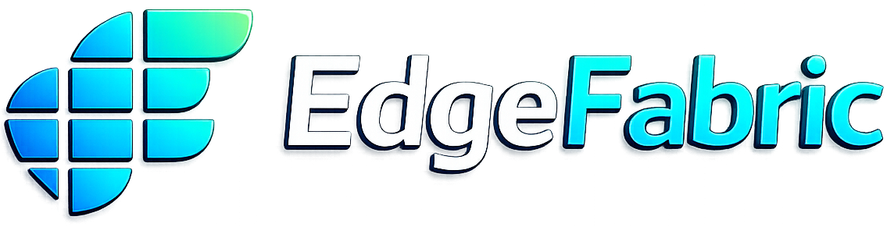
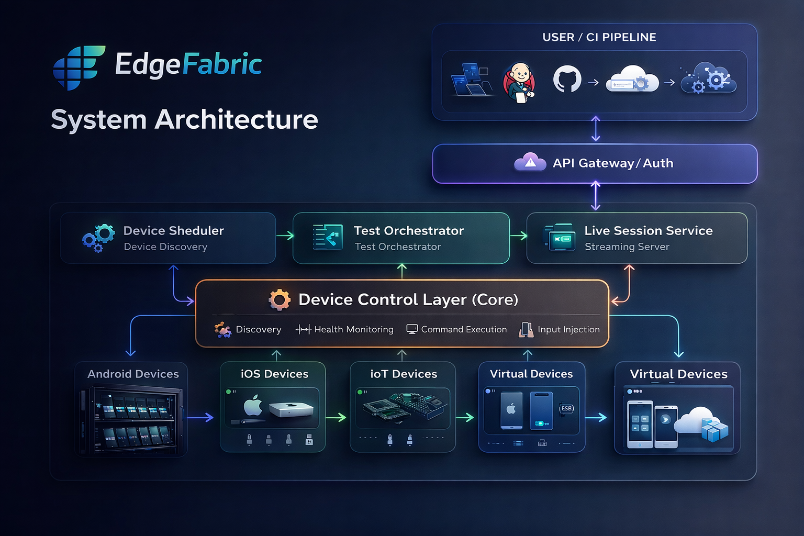
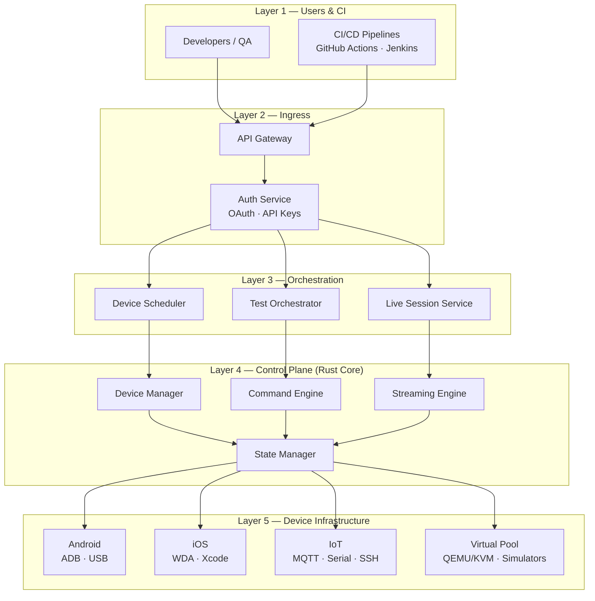
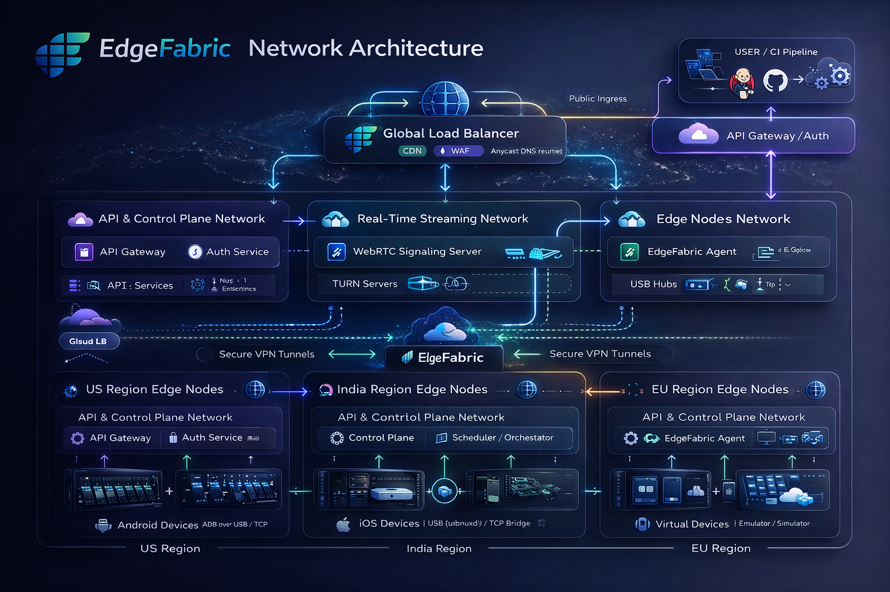
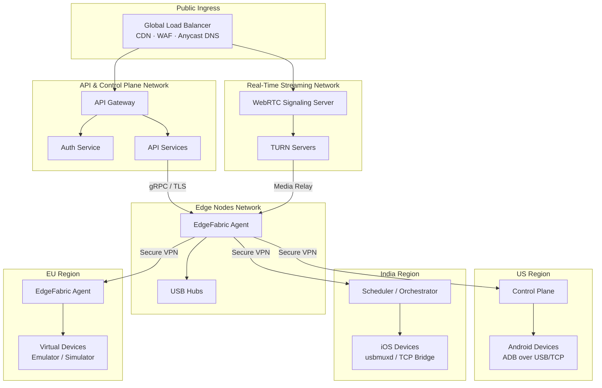
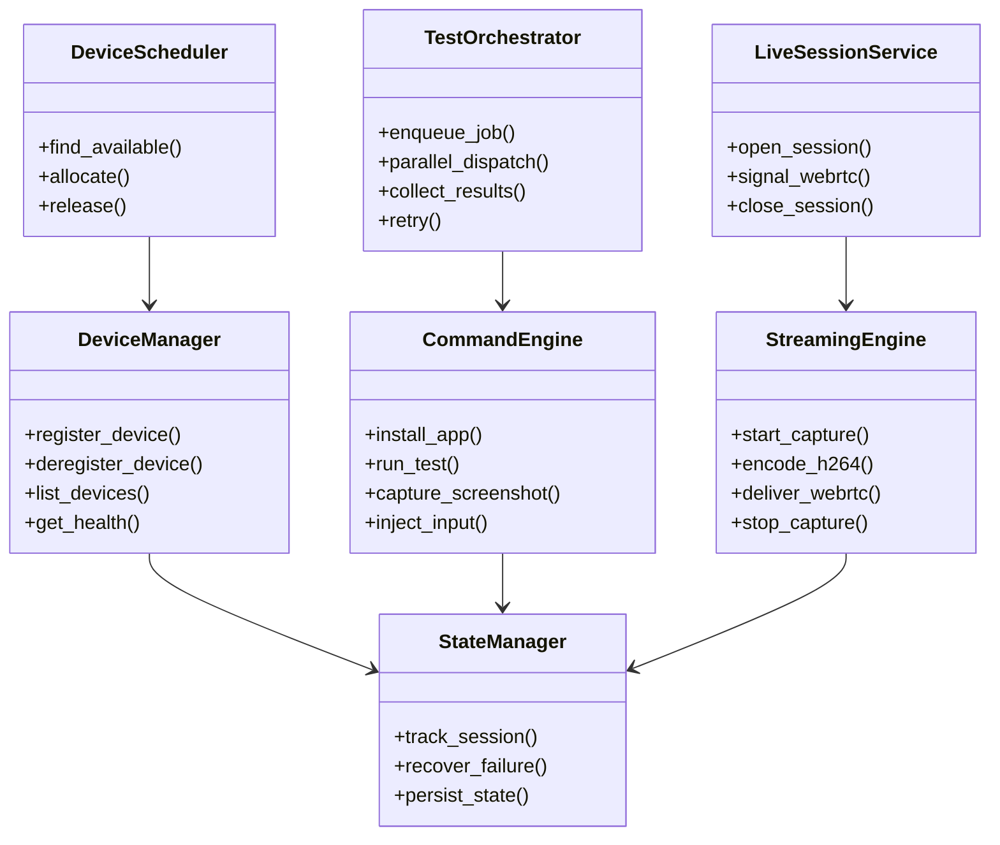
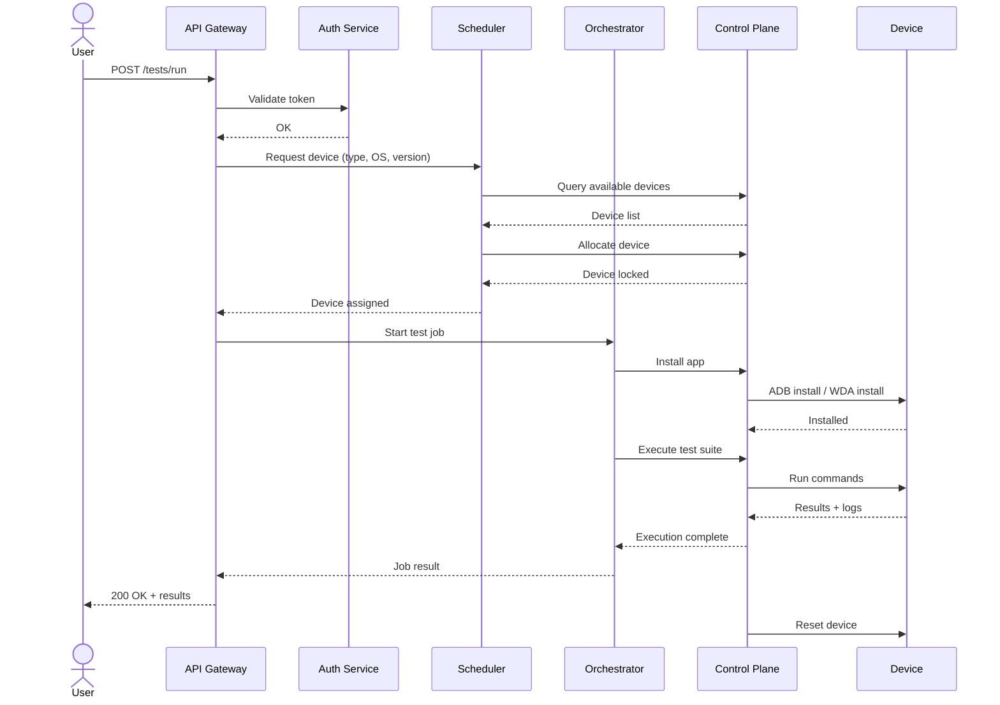
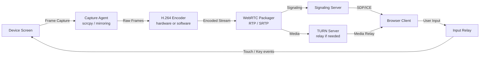
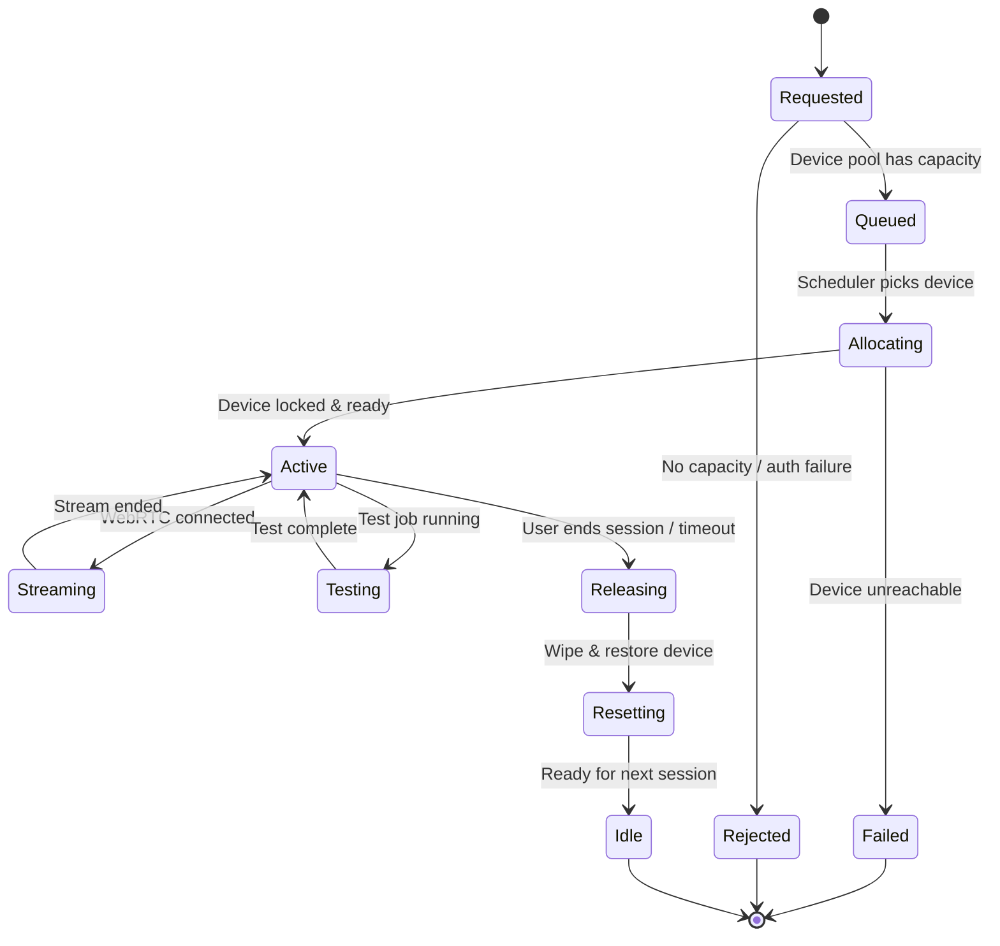
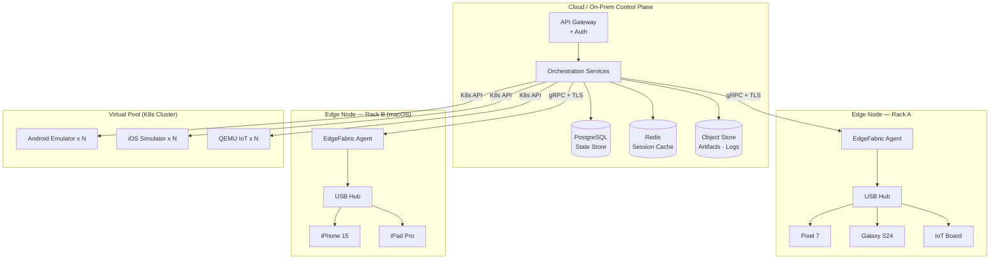

  

<h1 align="center">Architecture & Diagrams</h1>

  Visual reference for EdgeFabric's system topology, network layout, and component interactions.

---

## Table of Contents

- [System Architecture Overview](#system-architecture-overview)
- [Network Architecture](#network-architecture)
- [Layered Component Model](#layered-component-model)
- [Device Control Flow](#device-control-flow)
- [Streaming Pipeline](#streaming-pipeline)
- [Session Lifecycle](#session-lifecycle)
- [Deployment Topology](#deployment-topology)

---

## System Architecture Overview

> Full visual reference — see the high-resolution diagram below.

  

The platform is organized in five horizontal layers, each with clear responsibilities:

---

## Network Architecture

> Full visual reference — see the high-resolution diagram below.

  

---

## Layered Component Model

A detailed breakdown of every module inside the control plane.

---

## Device Control Flow

End-to-end flow for a test execution request.

---

## Streaming Pipeline

Low-latency WebRTC streaming from device to browser.

**Target Latency:** < 200 ms end-to-end

---

## Session Lifecycle

State machine for a device session.

---

## Deployment Topology

---

<i>Back to <a href="../README.md">README</a> · <a href="SYSTEM_DESIGN.md">System Design</a> · <a href="API_REFERENCE.md">API Reference</a></i>

