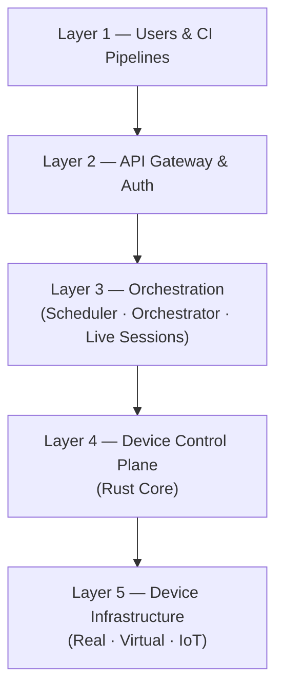
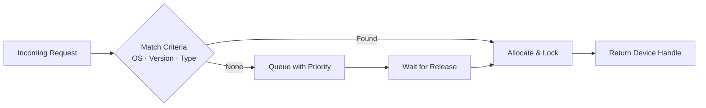
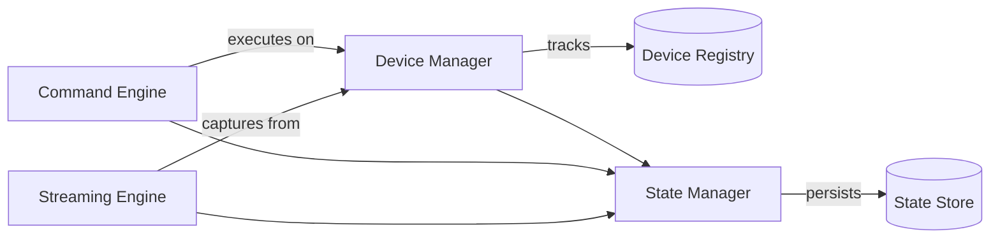
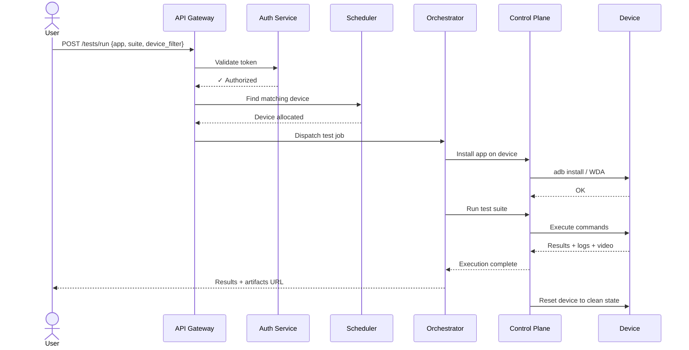
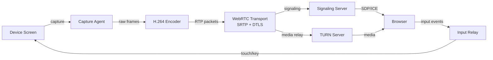
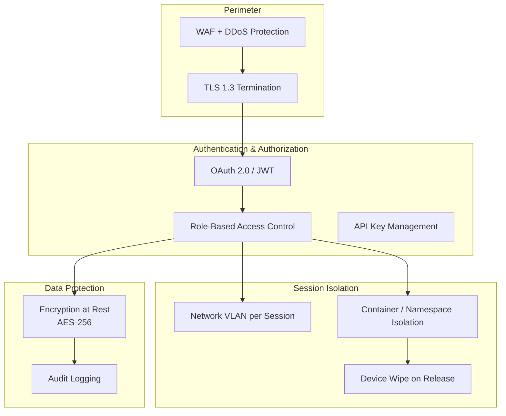
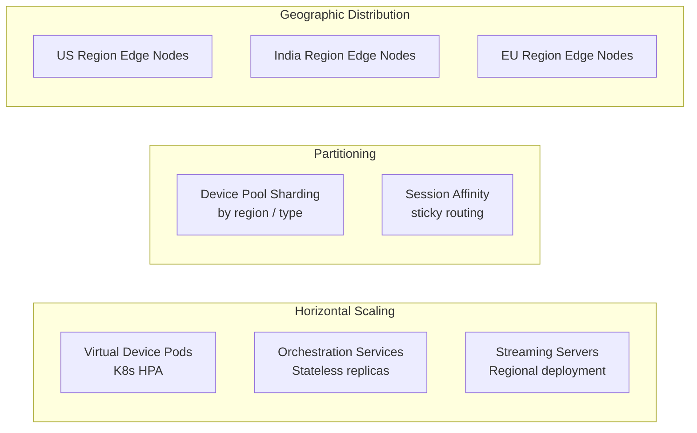

  

<h1 align="center">System Design Document</h1>

  Detailed design specification for the EdgeFabric unified device cloud platform.

---

## Table of Contents

- [Design Goals](#design-goals)
- [High-Level Architecture](#high-level-architecture)
- [Layer 1 — User & CI Pipeline](#layer-1--user--ci-pipeline)
- [Layer 2 — API Gateway & Authentication](#layer-2--api-gateway--authentication)
- [Layer 3 — Orchestration](#layer-3--orchestration)
- [Layer 4 — Device Control Plane (Rust Core)](#layer-4--device-control-plane-rust-core)
- [Layer 5 — Device Infrastructure](#layer-5--device-infrastructure)
- [Data Flow](#data-flow)
- [Streaming Architecture](#streaming-architecture)
- [Security Model](#security-model)
- [Deployment Model](#deployment-model)
- [Scalability Strategy](#scalability-strategy)
- [Failure Handling](#failure-handling)
- [Technology Decisions](#technology-decisions)
- [Design Studio Extension (Chip · PCB · Quantum)](#design-studio-extension-chip--pcb--quantum)
- [Future Enhancements](#future-enhancements)

---

## Design Goals

| Goal | Description |
|------|-------------|
| **Unified Abstraction** | Single API surface across Android, iOS, IoT — real and virtual |
| **Horizontal Scalability** | Scale virtual device pools independently of physical racks |
| **Low Latency** | < 200 ms screen streaming via WebRTC |
| **High Reliability** | Health monitoring, auto-recovery, session retry |
| **CI/CD Native** | First-class integration with GitHub Actions, Jenkins, etc. |
| **Secure Multi-Tenancy** | Session isolation, device wipe, RBAC, encrypted channels |

---

## High-Level Architecture

The system is divided into **five primary layers**.  See [ARCHITECTURE.md](ARCHITECTURE.md) for full diagrams.

---

## Layer 1 — User & CI Pipeline

### Actors

| Actor | Interaction |
|-------|-------------|
| Developers | Web dashboard, CLI, SDK |
| QA Engineers | Test management UI, API |
| CI/CD Systems | REST/gRPC API (GitHub Actions, Jenkins, GitLab CI) |

### Responsibilities
- Submit test jobs and automation scripts
- Request interactive device sessions
- Monitor execution results, logs, and video

---

## Layer 2 — API Gateway & Authentication

### Responsibilities
- Request routing and load balancing
- Authentication (OAuth 2.0 / API keys / JWT)
- Rate limiting and quota enforcement
- Multi-tenant request isolation

### Key API Endpoints

| Method | Endpoint | Description |
|--------|----------|-------------|
| `GET` | `/devices` | List available devices |
| `POST` | `/sessions` | Create a new device session |
| `POST` | `/tests/run` | Submit a test execution job |
| `GET` | `/logs/{session_id}` | Retrieve session logs |
| `GET` | `/stream/{session_id}` | WebRTC stream negotiation |

See [API_REFERENCE.md](API_REFERENCE.md) for full specification.

---

## Layer 3 — Orchestration

### Device Scheduler

**Allocation criteria:** device type, OS version, availability, test priority, geographic proximity.

### Test Orchestrator
- Accepts test jobs (APK/IPA + test suite)
- Distributes across allocated device pool
- Manages parallel execution, retries, and result aggregation

### Live Session Service
- Manages interactive WebRTC sessions
- Handles signaling (SDP offer/answer, ICE candidates)
- Streams video + logs in real time to browser clients

---

## Layer 4 — Device Control Plane (Rust Core)

This is the **heart of EdgeFabric** — built entirely in Rust for performance, safety, and low-level device control.

### Internal Modules

#### Device Manager
- Discovers and registers all connected devices (real + virtual)
- Maintains health heartbeats
- Exposes device capabilities and metadata

#### Command Engine
- Install apps (`adb install`, WDA, firmware flash)
- Run test suites
- Capture screenshots, logs, network traces
- Inject touch/keyboard input

#### Streaming Engine
- Frame capture from device screen (scrcpy for Android, mirroring for iOS)
- H.264 hardware/software encoding
- WebRTC packaging and delivery via SRTP

#### State Manager
- Tracks session and device state in PostgreSQL
- Caches hot state in Redis
- Handles failure detection and recovery workflows

---

## Layer 5 — Device Infrastructure

### Real Devices

| Platform | Connection | Control |
|----------|-----------|---------|
| **Android** | USB via ADB, TCP/IP ADB | ADB commands, scrcpy |
| **iOS** | USB via usbmuxd, TCP bridge | WebDriverAgent, Xcode tools |
| **IoT** | Serial, SSH, Network | MQTT, custom protocols |

### Virtual Devices

| Platform | Technology | Notes |
|----------|-----------|-------|
| **Android Emulator** | QEMU + KVM | Snapshot boot, headless, GPU passthrough |
| **iOS Simulator** | CoreSimulator | macOS host only, runs as user process |
| **IoT Simulation** | QEMU firmware emulation | MQTT-based sensor simulation, digital twins |

---

## Data Flow

End-to-end flow for a typical test execution:

---

## Streaming Architecture

| Metric | Target |
|--------|--------|
| End-to-end latency | < 200 ms |
| Resolution | Up to 1080p |
| Frame rate | 30–60 fps |
| Codec | H.264 (hardware-accelerated when available) |

---

## Security Model

| Control | Implementation |
|---------|---------------|
| Transport encryption | TLS 1.3 (API), DTLS + SRTP (WebRTC) |
| Session isolation | VLAN segmentation, container namespaces |
| Device sanitization | Full wipe + snapshot restore after each session |
| Access control | RBAC with tenant-scoped permissions |
| Audit trail | Immutable log of all device operations |

---

## Deployment Model

| Component | Deployment | Notes |
|-----------|-----------|-------|
| API Gateway + Auth | Cloud / on-prem VM | Horizontally scaled behind LB |
| Orchestration services | Cloud / on-prem VM | Stateless, auto-scaled |
| Control Plane | Cloud + Edge nodes | Central coordinator + per-rack agents |
| State Store | PostgreSQL (HA) | Replicated, with Redis cache |
| Artifact Store | S3-compatible | Logs, screenshots, video recordings |
| Edge Nodes | Bare-metal racks | Linux for Android/IoT, macOS for iOS |
| Virtual Pool | Kubernetes cluster | QEMU/KVM pods, auto-scaled |

---

## Scalability Strategy

- Virtual devices scale horizontally via Kubernetes HPA
- Orchestration services are stateless → scale linearly
- Device pools are sharded by region and type
- Edge clusters operate semi-autonomously with local caching

---

## Failure Handling

| Failure Scenario | Recovery Strategy |
|-----------------|-------------------|
| Device disconnect | Auto-detect via heartbeat, reallocate to standby |
| Emulator crash | Auto-restart from snapshot, retry test |
| Agent unreachable | Failover to alternate edge node in region |
| Test timeout | Configurable timeout + auto-retry with backoff |
| Network partition | Edge node queues commands, reconciles on reconnect |
| Control plane crash | Stateless restart, state recovered from PostgreSQL |

---

## Technology Decisions

| Component | Technology | Rationale |
|-----------|-----------|-----------|
| **Core platform** | Rust | Memory safety, zero-cost abstractions, async I/O |
| **API layer** | Axum + tonic (gRPC) | High-performance async Rust web frameworks |
| **Streaming** | WebRTC (webrtc-rs) | Low-latency, browser-native |
| **State store** | PostgreSQL | Reliable, ACID-compliant |
| **Cache** | Redis | Session state, device locks |
| **Message bus** | NATS | Lightweight pub/sub for internal events |
| **Android control** | ADB (via Rust bindings) | Industry standard |
| **iOS control** | WebDriverAgent | Best available open-source |
| **IoT** | MQTT (rumqttc) | Lightweight IoT protocol |
| **Container orchestration** | Kubernetes | Virtual device scaling |
| **Build system** | Cargo workspaces | Monorepo with shared crates |

---

## Design Studio Extension (Chip · PCB · Quantum)

EdgeFabric extends its device-cloud control plane to cover **hardware design from RTL/schematic through verification and tape-out/manufacturing**, reusing the same Rust core, scheduler, runner/lease model, artifact store, and audit log.

### Domains

| Domain | Surface | Backends | Tooling |
|--------|---------|----------|---------|
| **Chip** | Silicon Studio · RTL workbench · Schematic Editor · Floorplan · 3D Stack-up · Tape-out checklist | **vFPGA** (veer-vm software-defined chip) · **Hardware FPGA** (Xilinx/Intel/Lattice boards) | Yosys · nextpnr · OpenROAD · Verilator · Icarus · OpenSTA · KLayout · Magic · Netgen |
| **PCB** | PCB Studio · Schematic Editor (`PcbLib` skin) · Layout · 3D viewer · DRC/BOM/Gerber | Headless EDA jobs (no hardware lease needed) | KiCad CLI · ngspice · FreeCAD · OpenEMS · JLCPCB/PCBWay submit |
| **Quantum** | Circuit Designer · Accelerators · Jobs · VeerOS Hosts | VeerOS qsim · vFPGA cryo-control stubs | Qiskit/Cirq bridges (planned) |

### Shared Engine

The dashboard ships a single **domain-agnostic schematic engine** (`crates/ef-dashboard/src/components/schematic.rs`) — instances, pins, ortho-routed wires, drag-and-drop palette, undo, JSON export. Each domain provides a `SymbolLibrary` skin (`ChipLib` today; `PcbLib` planned). The trait is `Send + Sync + 'static` so libraries can be passed to Leptos closures.

### Backends as Leases

Both **vFPGA** (veer-vm process) and **hardware FPGA** boards expose the same lifecycle (`provision → start → attach project → run job → stop`) and the same reservation contract as iOS build runners. They are stored in `chip_backends` and reserved via `chip_backend_leases`, with status (`idle / booting / running / error / offline`) surfaced live on `/silicon/backends`.

### Job Model

`ef-orchestrator` is extended with `chip.*` and `pcb.*` job kinds: `sim`, `synth`, `pnr`, `sta`, `drc`, `lvs`, `program`, `gerber`, `spice`, `3d_render`. Each job emits incremental logs (NDJSON/WebSocket) and produces typed artifacts (VCD, FST, netlist, bitstream, Gerber, ODB++, GDS, BOM) stored in the unified artifact store.

### Cross-cutting

- **Tenancy & RBAC**: chip projects, PCB projects, libraries, parts, and PDKs are tenant-scoped. New roles: `chip.viewer / chip.designer / chip.signoff_owner`, `pcb.viewer / pcb.designer / pcb.releaser`.
- **IP protection**: encryption-at-rest for RTL/GDS; NDA-gated PDKs require per-tenant entitlements.
- **AI co-pilot**: shared `ef-copilot` service with domain prompts (RTL gen, SDC suggestions, DRC explanation, footprint suggestion, BOM optimization).
- **Observability**: shared metrics (`chip_jobs_running`, `pcb_jobs_failed_total`, `fpga_backends_online`) feed the same Prometheus/Grafana stack.

See [CHIP_DESIGN_INTEGRATION_PLAN.md](../CHIP_DESIGN_INTEGRATION_PLAN.md), [PCB_DESIGN_INTEGRATION_PLAN.md](../PCB_DESIGN_INTEGRATION_PLAN.md), [QUANTUM_INTEGRATION_PLAN.md](../QUANTUM_INTEGRATION_PLAN.md), and [TODO.md](../TODO.md) for phase-by-phase execution status, full API surfaces, and migration schemas.

---

## Future Enhancements

- [ ] AI-powered smart device scheduling (predict test-to-device affinity)
- [ ] GPU-accelerated streaming with hardware encoders
- [ ] Advanced network simulation (latency, bandwidth, packet loss)
- [ ] Visual regression testing built into the platform
- [ ] Distributed edge clusters with autonomous failover
- [ ] Plugin system for custom device protocols

---

<i>Back to <a href="../README.md">README</a> · <a href="ARCHITECTURE.md">Architecture & Diagrams</a> · <a href="API_REFERENCE.md">API Reference</a></i>

